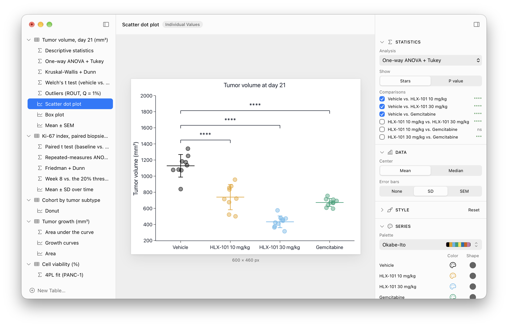

# Helix

**Scientific data analysis, simplified.**

Organize, analyze and visualize scientific data, from raw numbers to publication-ready
graphs. Helix is a free, open-source and private alternative to GraphPad Prism for macOS.

Three engines do the work: a fast data grid built for Helix, **R**, the reference for
statistics (through [webR](https://github.com/r-wasm/webr), R compiled to WebAssembly), and
**[Plotly](https://plotly.com/javascript/)** for the graphs. Everything runs on your Mac.



## Download

Get the latest version from the [Releases page](https://github.com/mickaphd/Helix/releases/latest):

- `Helix_…_aarch64.dmg` for Macs with Apple Silicon (M1 and later)
- `Helix_…_x64.dmg` for Macs with an Intel processor

Requires macOS 13.3 (Ventura) or later. Open the DMG and drag **Helix** into the
**Applications** folder. Helix is signed and notarized by Apple, so it opens like any other app.

When a new version is out, Helix tells you (Helix › Check for Updates…): download it and
replace the old one.

## What Helix does

Each **table** holds its own **analyses** and **graphs**. Change a value, and every result
and figure that uses it updates at once.

### Tables

Five table types, each offering the analyses and graphs that fit it:

- **Column:** groups side by side (control, doses, treatments)
- **XY:** a response against a dose, a time or a concentration
- **Grouped:** groups across rows (time points, genes), with replicates
- **Multiple Variables:** one row per subject, one column per variable
- **Contingency:** counts of outcomes

And a spreadsheet that feels like one:

- Copy and paste with Excel or Numbers, fill down, find, resize columns, keep the titles
  visible as you scroll
- Name each row (a mouse, a patient, a gene): the names follow into results and graphs
- Exclude a value from the analyses without deleting it

### Analyses

- **Guided:** an assistant asks which data sets to analyze, whether they are
  paired and whether they follow a normal distribution (or checks it for you with
  Shapiro-Wilk), then runs the right test
- **Every number comes from R**, the reference for statistics
- **Two groups:** unpaired, Welch, paired and ratio t tests, Mann-Whitney, Wilcoxon
- **More groups:** one-way and repeated-measures ANOVA, Kruskal-Wallis, Friedman, with multiple
  comparisons (Tukey, Bonferroni, Dunn)
- **Grouped data:** two-way ANOVA (ordinary, repeated measures, Scheirer-Ray-Hare) and
  multiple t tests with Holm or FDR correction
- **Curves:** 4PL dose-response (EC50, Hill slope), one-site binding, lines and polynomials
- **Clear results:** the exact test that ran, whether it is significant, every statistic,
  multiple comparisons and descriptive statistics, ready to copy
- Analyses follow the data: rename a column and they follow it, edit a value and they run again

### Graphs

- **Ready for a paper by default**
- **Statistics on the graph:** significance stars or P values from your analyses, regression
  lines with their confidence band and equation, fitted dose-response curves with their EC50
- **Colors that work:** 15 palettes from the scientific literature (Okabe-Ito, Paul Tol,
  Viridis, Batlow…), colorblind-friendly ones first, each reversible; or make your own,
  kept on your Mac
- **Style every series:** color, point shape, dashed lines, fill patterns; and the whole graph:
  fill opacity, outlines, error bars (thickness, caps, color, direction)
- **Style single points:** click or drag over them to change their color, shape or size, or
  show their name; on a volcano plot, find genes by name
- **Match:** give a graph the look of another one, choosing what it takes
- **Lay it out:** move the legend and notes, resize by dragging an axis or typing a size, set
  each axis's range and step, white or transparent background
- **Export** as PNG or JPG at 150, 300 or 600 DPI, at their true printed size, or as SVG; or
  copy and paste into Keynote, PowerPoint or Word

### Projects

- A native Mac app: real menus and shortcuts, light and dark mode, your accent color,
  resizable sidebar and inspector
- Undo and redo everything, across the whole project
- Several projects at once, each in its own window; the ones still open when you quit come
  back at the next launch
- Open projects: a Helix file (`.hlx`) is plain JSON, described in
  [FILE-FORMAT.md](FILE-FORMAT.md), so your data are never locked in

**Try it:** Help › Sample Project opens a made-up preclinical study, from mice to patients,
with every kind of table and most analyses and graphs ([also here](samples/Helix%20Sample.hlx)).

## Privacy

Helix works entirely on your Mac: your data never leave it, and there is no
telemetry in the app. Its only connection is a daily check on GitHub for a newer version.

## Building from source

You need [Node.js](https://nodejs.org) 24 or later, [Rust](https://rustup.rs), and the
Xcode Command Line Tools (`xcode-select --install`).

```bash
npm ci            # install
npm run dev       # run Helix with live reload
npm test          # check every analysis and graph against their reference results
npm run build     # build the two DMGs
```

Building the two DMGs needs both Mac targets for Rust, once:
`rustup target add aarch64-apple-darwin x86_64-apple-darwin`.

## License

Helix is free software: you can redistribute it and modify it under the terms of the
[GNU General Public License](LICENSE), version 3 or later. It comes with no warranty.

© 2026 mickaphd · [helix-desktop.com](https://www.helix-desktop.com)

Helix is free and always will be. If it saves you time, you can
[buy me a coffee](https://buymeacoffee.com/mickaphd) ☕

## Acknowledgments

Helix stands on the shoulders of [R](https://www.r-project.org) and
[webR](https://github.com/r-wasm/webr), which bring R to the app,
[Plotly.js](https://plotly.com/javascript/) for the graphs, [Phosphor Icons](https://phosphoricons.com)
for its icons, and [Tauri](https://tauri.app) and [React](https://react.dev) for the app itself. See
[THIRD-PARTY-NOTICES.md](THIRD-PARTY-NOTICES.md) for all of them and their licenses.

GraphPad Prism is a trademark of GraphPad Software, LLC. Helix is an independent project,
not affiliated with or endorsed by GraphPad Software.
